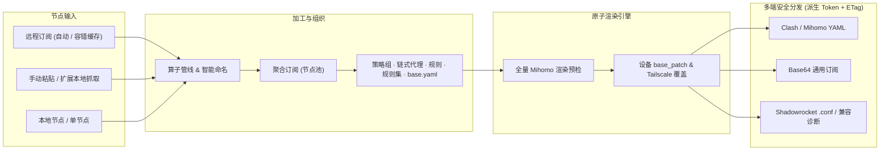

<div align="center">


# ProxyManager

**面向 Clash / Mihomo 的下一代自部署订阅与配置工作台**

*把订阅源、规则、策略组与设备差异全部结构化：可视、可校验、可撤销，也能让 AI 直接协同操作*

<p align="center"><a href="https://vercel.com/new/clone?repository-url=https%3A%2F%2Fgithub.com%2Fcliouo%2Fproxymanager&root-directory=web&env=ADMIN_KEY,SUB_TOKEN,NODE_HANDLE_SECRET"></a>     <a href="LICENSE"></a></p>

<p align="center"><a href="#-核心亮点">核心亮点</a> · <a href="#-它解决哪些常见痛点">解决什么问题</a> · <a href="#-系统架构一览">架构一览</a> · <a href="#-页面即工具站内-ai-与-webmcp">AI 与 WebMCP</a> · <a href="#-多端订阅分发">订阅分发</a> · <a href="#-5-分钟免费部署">快速部署</a> · <a href="#-浏览器扩展">浏览器扩展</a></p>

</div>

---

## ✨ 核心亮点

<table>
  <tr>
    <td width="50%" valign="top">
      <h3>🧭 全链路结构化与零坏配置落盘</h3>
      订阅源、聚合订阅、策略组、规则、规则集、配置文件与设备全部一等建模。每次写入前强制预演最终 Mihomo 渲染结果，版本一致才原子提交；删除或重命名时自动提示全部引用影响面。
    </td>
    <td width="50%" valign="top">
      <h3>🤖 页面即工具：站内 AI + 原生 WebMCP</h3>
      基于 <code>@ui-sdk/react</code> 构建，内置侧边栏 AI（<code>⌘J</code>）与浏览器原生 <strong>WebMCP</strong>（<code>document.modelContext</code>）共用同一套页面工具，无需另装 MCP Server。所有写入操作都在对话流内出确认卡并高亮页面目标。
    </td>
  </tr>
  <tr>
    <td width="50%" valign="top">
      <h3>🏷️ 算子管线与 AI 智能命名工作台</h3>
      顺序敏感的节点加工流水线（过滤、正则替换、去重、排序、加国旗、批量属性），每一步都可对真实节点实时预览；智能命名结合持久化编号与 AI 识别地区/倍率，订阅更新节点序号不飘移。
    </td>
    <td width="50%" valign="top">
      <h3>📱 多配置 · 模版 · 多设备覆盖 &amp; Tailscale</h3>
      一份配置文件可挂多台设备，按设备单独叠加 <code>base_patch</code>（端口、TUN、LAN）与嵌入式多实例 <strong>Tailscale</strong> 出站（密钥脱敏）；支持用模版一键派生新配置，模版不对外分发。
    </td>
  </tr>
  <tr>
    <td width="50%" valign="top">
      <h3>🔗 智能前置池链式代理 &amp; 分流桑基图</h3>
      支持固定中转与 <code>url-test</code> / <code>fallback</code> 智能前置池，上游机场换节点名也不断链。总览页自带交互式分流桑基图，策略组正则筛选前可先对真实节点试算，规则页支持域名命中测试。
    </td>
    <td width="50%" valign="top">
      <h3>🌐 防云端屏蔽拉取 + 浏览器测速写规则</h3>
      远程订阅支持服务端自动拉取（带失败回退缓存）、手工粘贴/上传，或配合 Chrome MV3 扩展走本地网络一键抓取上传；扩展还可采集当前页域名、调用本地 Clash 测速并一键写回分流规则。
    </td>
  </tr>
</table>

## 💡 它解决哪些常见痛点

| 常见痛点 | 传统文件托管 / 手写 YAML | ProxyManager 的做法 |
| --- | --- | --- |
| **资源引用关系** | 靠文件名与人脑记忆，改名容易把策略组或规则弄断 | 所有实体结构化关联，删除拦下并列出引用方，重命名自动级联 |
| **坏配置风险** | 写完直接下发，客户端刷新报错才发现语法或引用有误 | 写入前强制全量渲染预检 + CAS 乐观锁，坏配置落不了盘 |
| **多设备差异** | 给手机、电脑、软路由各抄一份 YAML，改一条规则要同步三次 | 一份配置共享策略与规则，每台设备独立叠 `base_patch` 与 Tailscale |
| **机场屏蔽云端 IP** | 服务器拉不到就彻底失效 | 支持手动导入、失败回退陈旧缓存，或浏览器扩展本地网络一键抓取 |
| **节点命名与序号** | 上游一增删节点，正则误吞或序号全乱 | 实时试算筛选正则 + 智能命名工作台 + 持久化节点编号 |
| **AI 协同管理** | 复制大段 YAML 贴进聊天框，改完再手动贴回去 | 站内 AI 助手与 WebMCP 直接操作真实界面，写入带确认卡与撤销审计 |

## 🗺️ 系统架构一览



## 🤖 页面即工具：站内 AI 与 WebMCP

ProxyManager 不再单独维护一套与前端割裂的服务端 AI 工具或外挂 MCP 插件。整个管理界面本身就是 Agent 的执行层：

- **站内 AI 侧边栏（`⌘J` / `Ctrl+J`）**：在「设置 → AI 助手」填入 DeepSeek 或任意 OpenAI 兼容模型即可使用（支持思考模式流式输出，浏览器直连模型接口）。
- **原生 WebMCP 同步暴露**：只要打开网页，支持 WebMCP（`document.modelContext`）的浏览器或外部 Agent 自动发现全部 12 个工具，与站内 AI 共用同一套交互和确认门禁。
- **不盲等、不错判、不越权**：
  - `snapshot` / `query` / `act` 直接读写当前页面控件与列表，配合基于 `#main` DOM 变化的 `wait_for` 局部等待，目标出现即唤醒，不必等页面上无关的后台请求。
  - 扩展工具内置 Mihomo 官方文档查询（DeepWiki）、受 SSRF 防护的外部文本抓取，以及冗余直连别名迁移和旧配置/旧链死锁原子修复。
  - 每次写入或删除都会在对话流内弹出带具体后果说明的确认卡片，同时高亮页面上的目标按钮；业务弹窗遮罩仅作用于主工作区，侧边栏始终清晰可读、随时可点「停止」；所有操作记入 `/history` 审计日志（标注 Web / AI 助手 / WebMCP / 扩展来源）并支持一键撤销。

## 📡 多端订阅分发

系统使用主密钥 `SUB_TOKEN` 为每个资源派生独立的 `<token>`（不在分享链接中暴露主密钥），并支持通过 `SUB_TOKEN_PREV` 零停机轮换密钥。所有分发地址均可在界面一键复制并生成二维码：

| 目标 | 路径 | 说明 |
| --- | --- | --- |
| **完整配置** | `/api/sub/<token>/<profile>` | 默认 Mihomo YAML；支持 `?format=base64`（仅节点）、`?format=shadowrocket`（原生 `.conf`） |
| **单设备配置** | `/api/sub/<token>/<profile>/<device>` | 自动叠加设备 `base_patch` 与 Tailscale；支持 `?materialize=proxy-groups` 展开动态策略组、`?client=shadowrocket`（可加 `&strict=1`） |
| **单订阅源节点** | `/api/sub/<token>/source/<name>` | 导出加工去重后的节点，默认 Clash provider YAML，可加 `?format=base64` |
| **聚合订阅节点** | `/api/sub/<token>/collection/<slug>` | 合并成员并运行聚合管线后导出，默认 provider YAML，可加 `?format=base64` |

通用参数：`?noCache=1` 强制跳过订阅缓存向源站重新拉取。分发 token 与读取缓存的兼容性说明见 [`docs/audit-fixes-2026-10-12.md`](docs/audit-fixes-2026-10-12.md)（旧式裸名称派生 token 不再接受）。

<details>
<summary>📱 Shadowrocket（iOS）两种导入方式与兼容细节</summary>

- **原生 `.conf` 模式**：在「订阅链接 → 通用 Base64」下，将共享节点链接作为 Subscribe 添加，备注填 `ProxyManager-Nodes`，再在 Shadowrocket「配置」页导入配套的 `?format=shadowrocket` 分流配置（节点与配置分开更新）。导出支持 `select` / `url-test`、按节点名筛选，以及域名、IP、GEOIP 和 `FINAL` 规则；桌面进程规则会跳过并在注释中计数；测速由 Shadowrocket 执行，Mihomo 的 `lazy` 与 `empty-fallback` 不迁移；其余未支持属性或规则返回 422。该入口仅导出共享配置中的策略组和规则，不含 DNS 或设备覆盖。
- **设备 Clash YAML 模式**：设备专用链接加 `?client=shadowrocket` 可下载含设备覆盖的 Clash YAML 而非原生 `.conf`。已知不兼容的选路行为会返回 422 兼容性诊断，尚未验证的照常下发；在设备详情页点「重新检查」或追加 `&strict=1` 可让待验证项同样返回 422。

</details>

## 🚀 5 分钟免费部署

**Vercel + Upstash Redis** 免费额度即可流畅运行：

1. 点击顶部 **Deploy to Vercel** 或 Fork 后在 [Vercel](https://vercel.com) 导入，**Root Directory 设为 `web`**，Node.js 版本选 **24.x**。
2. 在项目 **Storage** 标签页创建 **Upstash Redis** 数据库（自动注入 `KV_REST_API_URL` 与 `KV_REST_API_TOKEN`）。
3. 配置环境变量：

   | 变量 | 必需 | 说明 |
   | --- | :---: | --- |
   | `ADMIN_KEY` | ✅ | 控制台登录与 `/api/v1/*` 鉴权 Bearer token，自行生成强随机串 |
   | `SUB_TOKEN` | ✅ | 订阅分发主密钥，用于派生和校验各资源分发链接 token |
   | `NODE_HANDLE_SECRET` | ✅ | 智能命名工作台 opaque 句柄的 HMAC 密钥，至少 32 字节（`openssl rand -hex 32`），多实例间保持一致 |
   | `SUB_TOKEN_PREV` | ⬜ | 轮换 `SUB_TOKEN` 时填入旧密钥实现零停机过渡，客户端刷新后移除 |
   | `DEEPSEEK_API_KEY` | ⬜ | 仅作智能命名分析的服务端兜底 key；站内 AI 助手直接在「设置 → AI 助手」配置 |
   | `DEEPWIKI_MCP_URL` | ⬜ | 自定义 Mihomo 文档查询服务的 MCP 地址 |

4. 访问 `https://<你的域名>/` 用 `ADMIN_KEY` 登录，首次空库会自动进入 `/welcome` 初始化引导，一键创建默认配置与起步策略组/规则。

> [!IMPORTANT]
> **`NODE_HANDLE_SECRET` 必须在上线前配置好强随机值。** 缺失或弱密钥时，智能命名工作台与分析接口会主动拒绝服务；轮换该密钥会使在途会话的临时句柄失效，建议在维护窗口内操作。

<details>
<summary>💻 本地开发与常用命令</summary>

仓库根目录配了 `mise.toml` 锁定 Node 24（也可直接使用本机 Node 24）：

```bash
cd web
npm install
npm run vercel:link      # 关联 Vercel 项目（一次性）
npm run vercel:env:pull  # 拉取环境变量到 web/.env.local
npm run dev              # 启动本地服务 http://localhost:3000
```

常用开发脚本（在 `web/` 下执行）：

```bash
npm run test             # Vitest 全量测试（170+ 测试文件，3,100+ 用例）
npm run typecheck        # TypeScript 严格类型检查
npm run lint             # ESLint 检查
npm run format           # Prettier 格式化
```

完整 OpenAPI 3.1 规范由 Zod schema 自动生成，启动后携带 `ADMIN_KEY` 访问 `/api/v1/openapi.json` 获取。

</details>

## 🧩 浏览器扩展

Chrome MV3 伴生扩展位于 [`extension/`](extension/)，带来两项网页端无法直接完成的本地能力：

1. **当前页域名采集 + 本地 Clash 测速写规则**：自动记录当前标签页触达的全部域名，调用本地 Clash / Mihomo external controller 对比各地区策略组延迟，一键将规则写入后端的 `manual` 锚点。
2. **一键本地网络拉取订阅**：当机场屏蔽 Vercel / 云端 IP 时，扩展通过你的本机网络抓取订阅原文并提交给后端校验入库（页面桥接只传订阅 ID，不暴露 `ADMIN_KEY` 或订阅地址）。

```bash
cd extension
npm install
npm run build            # 产物输出至 extension/build/chrome-mv3/，Chrome 开发者模式加载即可
```

详细配置与打包 `.crx` 说明见 [`extension/README.md`](extension/README.md)。

## 🗂️ 仓库结构与技术栈

```text
proxymanager/
├── web/              Next.js 16 全栈应用：管理 UI、REST API 与渲染引擎
├── extension/        Chrome MV3 扩展（WXT）：域名测速写规则 + 本地订阅抓取
├── docs/             协议兼容性矩阵与历史修复说明
├── mise.toml         统一 Node 24 开发环境
├── DESIGN.md         UI 设计规范入口（最新前端规范见 web/DESIGN.md）
└── REQUIREMENTS.md   需求与演进记录
```

- **前端与组件**：Next.js 16（App Router）· React 19 · TypeScript strict · Tailwind CSS 4 · `@ui-sdk/react` · CodeMirror 6 · Motion
- **数据与校验**：Upstash Redis · Zod 4 · `@asteasolutions/zod-to-openapi`（OpenAPI 3.1）
- **AI 与 WebMCP**：`@ui-sdk/react/agent` · 浏览器原生 WebMCP（`document.modelContext`）· 浏览器直连 OpenAI 兼容流式接口
- **扩展与测试**：WXT（Chrome MV3）· Vitest（Node + jsdom）· Testing Library · Playwright

## 📐 设计原则

- **只画真实能力**：ProxyManager 是配置组装器，本身不代理流量，不伪造节点延迟或在线状态；策略组健康检查参数是下发给客户端的静态配置。
- **写操作可校验、可追溯**：保存前校验完整渲染结果，AI 写入必须在对话流内经用户确认，审计历史保留操作来源并支持撤销。
- **引用完整性可见**：删除与重命名都会先展示受影响的配置、策略组与规则范围。

## 🙏 致谢与免责声明

- 致谢 [Sub-Store](https://github.com/sub-store-org/Sub-Store)（本项目最初的灵感来源，其节点算子与订阅处理思路深刻影响了 ProxyManager 的演进）以及 [mihomo](https://github.com/MetaCubeX/mihomo)（配置语义与校验规则的事实标准）。
- 本项目仅作为代理客户端的配置管理工具，不提供任何代理服务或节点，请在遵守当地法律法规的前提下使用。
- 开源协议：[MIT License](LICENSE)。
